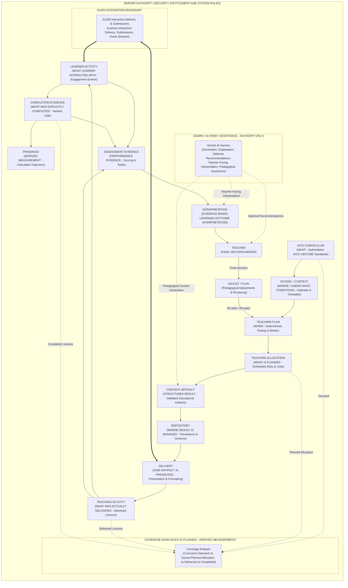

# ECG Master Architecture & Governance Constitution (Phase 37A)

**Product:** Exameno CBE Content Generator (ECG)  
**Document Version:** 1.0 (Phase 37A Master Architecture)  
**Status:** Authoritative Governance Reference  

---

## 1. Overview & Purpose

The **ECG Master Architecture Diagram** and this accompanying **Architecture Governance Document** serve as the visual and structural constitution for the Exameno CBE Content Generator (ECG) platform.

This architecture defines the strict boundaries, data flows, and authority layers governing curriculum ingestion, school configuration, teaching plan pacing, content generation, classroom delivery, learner progress tracking, assessment interpretation, and teacher decision-making.

> **Mandate:** This document is NOT decorative. Every future implementation phase MUST be checked against this Master Architecture before its checkpoint is approved.

---

## 2. Authoritative ECG Master Architecture Diagram



---

## 3. Canonical Architectural Terminology & Layer Definitions

| Term | Architectural Meaning | Layer Responsibility |
|---|---|---|
| **Curriculum** | **WHAT** | Authoritative, school-independent KICD CBC/CBE learning strands, sub-strands, specific learning outcomes (SLOs), and suggested lesson allocations. |
| **School** | **WHERE / UNDER WHAT CONDITIONS** | School configuration defining teaching weeks, lessons per week, academic calendar, holidays, and school closures. |
| **Teaching Plan** | **WHEN** | Deterministic calendar-pacing plan assigning curriculum sub-strands and outcomes to specific teaching weeks and lesson slots. |
| **Teaching Allocation** | **WHAT IS PLANNED** | Specific scheduled lesson slot unit assigned to a teacher, class, and learning outcome. |
| **Coverage** | **HOW MUCH IS PLANNED** | Derived measurement comparing KICD curriculum demand against school planned allocations, delivered lessons, and completed lessons. |
| **Gemini** | **HOW / ASSISTANCE** | Cross-cutting AI advisory layer assisting with content generation, explanations, optional recommendations, and teacher-facing interpretations. |
| **ContentArtifact** | **STRUCTURED RESULT** | Canonical structured output (lesson plan, assessment, note, scheme) validated against schema and stored with full provenance. |
| **Repository** | **WHERE RESULT IS MANAGED** | Operational persistence layer handling versioning, retrieval, filtering, school isolation, archiving, and restoration. |
| **Delivery** | **HOW ARTIFACT IS PRESENTED** | Formatting and presentation layer rendering artifacts for classroom instruction, print, or digital display. |
| **Teaching Activity** | **WHAT WAS ACTUALLY DELIVERED** | Logged classroom execution record representing an actual lesson delivered by a teacher. |
| **Learner Activity** | **WHAT LEARNER INTERACTED WITH** | Learner engagement events, submission interactions, and activity logs. |
| **Completion Evidence** | **WHAT WAS EXPLICITLY COMPLETED** | Verified completion logs backed by teacher confirmation or non-revoked digital evidence. |
| **Progress** | **DERIVED MEASUREMENT** | Calculated trajectory derived from verified completion evidence and outcome coverage history. |
| **Assessment Evidence** | **PERFORMANCE EVIDENCE** | Rubric evaluations, scored tasks, and CBA performance records. |
| **Interpretation** | **EVIDENCE-BASED LEARNING OUTCOME INTERPRETATION** | Analytical synthesis of assessment performance and completion evidence mapping learner understanding to outcomes. |
| **Teacher** | **FINAL DECISION-MAKER** | The human authority who reviews interpretations and makes pedagogical decisions to adjust, re-pace, or remediate teaching plans. |
| **Server** | **AUTHORITY FOR SECURITY, ENTITLEMENT AND SYSTEM RULES** | Backend security layer enforcing authentication, authorization, school tenancy, IDOR protection, quotas, and audit logs. |

---

## 4. Server Authority Boundary (Cross-Cutting Authority)

The **Server Authority Layer** encapsulates the entire application environment. Client applications, web browsers, and third-party tools are treated as untrusted inputs.

### Server Authoritative Responsibilities:
1. **Authentication & Authorization:** Validates user identity, credentials, and role permissions.
2. **School Multi-Tenancy & Isolation:** Enforces school ownership boundaries (`schoolId`). Cross-school access attempts are strictly rejected.
3. **Teacher Membership & Class Ownership:** Validates teacher-to-class assignments before permitting plan or artifact creation.
4. **IDOR Protection:** Rejects unauthorized access to resource IDs across tenants or user roles.
5. **Quota Enforcement:** Server-side atomic counter tracking for generation and storage entitlements.
6. **System State & Audit Logging:** Immutable logging of security, artifact creation, update, and deletion events (`AuditService`).

---

## 5. Gemini / AI Boundary (Cross-Cutting Advisory)

Gemini operates exclusively as a **cross-cutting advisory layer** (`HOW / ASSISTANCE`).

```text
               AUTHORITATIVE CONTEXT
                        │
                        ▼
                SERVER GOVERNANCE
             ┌──────────┼──────────┐
             │          │          │
        AUTH RULES   QUOTAS    AI GOVERNANCE
             │          │          │
             └──────────┼──────────┘
                        ▼
                APPROVED AI MODEL
                        │
                        ▼
                     GEMINI
                        │
                        ▼
               STRUCTURED OUTPUT
                        │
                        ▼
             DETERMINISTIC VALIDATION
                        │
                        ▼
                 CONTENT ARTIFACT
```

### What Gemini May Do:
- Generate pedagogical content within deterministic ECG constraints.
- Produce explanations, teaching suggestions, and draft assessments.
- Formulate teacher-facing interpretations and optional recommendations.

### What Gemini MUST NOT Be Authoritative For (FORBIDDEN):
- Curriculum identity, curriculum versioning, or curriculum structure.
- Specific Learning Outcomes (SLOs) or KICD suggested lesson allocations.
- Available teaching capacity, calendar weeks, or lessons per week.
- School authorization, school membership, or learner identity.
- Coverage truth or progress calculations.
- Security, entitlement, quota limits, or audit authority.

---

## 6. Teacher Decision Loop (Human-In-The-Loop Authority)

The architecture establishes the **Teacher as the Final Decision-Maker**:

```text
Interpretation
      ↓
Teacher Decision
      ↓
Adjust / Plan
      ↓
Teaching Plan
      ↓
Classroom Delivery
```

1. **Evidence Synthesis:** Assessment evidence and completion evidence are synthesized into learning outcome interpretations.
2. **AI Assistance:** Gemini may provide teacher-facing insights or suggestions regarding learning gaps.
3. **Teacher Authority:** The teacher reviews interpretations and decides whether to re-allocate slots, schedule remedial sessions, or proceed to new strands.
4. **Plan Adjustment:** The teacher applies decisions by adjusting the `TeachingPlan`, which updates the deterministic pacing schedule.

---

## 7. Coverage Position & Derived Non-Equivalence Principles

**Coverage** is a derived measurement layer. It evaluates four distinct states without mutating the canonical curriculum:

```text
               KICD Curriculum Demand (Suggested Allocation)
                                   │
                                   ▼
               School Planned Allocation (Teaching Plan)
                                   │
                                   ▼
               Delivered Lessons (Teaching Activity)
                                   │
                                   ▼
               Completed Lessons (Completion Evidence)
```

### Core Non-Equivalence Equations:
- **Curriculum ≠ Coverage:** Curriculum defines the authoritative standard (*WHAT*); Coverage measures planned vs. delivered execution (*HOW MUCH*).
- **Teaching Plan ≠ Curriculum:** Teaching Plan adapts curriculum to school calendar conditions (*WHEN*); it does not alter KICD standards.
- **Teaching Activity ≠ Completion Evidence:** Delivering a lesson (`Delivered`) does not automatically establish verified completion (`Completed`).
- **Completion ≠ Mastery:** Completing a lesson slot does not equate to learner competency or mastery.
- **Assessment ≠ Curriculum Authority:** Assessment measures learner performance; it never redefines curriculum standards.

---

## 8. ELMS Integration Boundary

The **Exameno Learner Management System (ELMS)** integrates as a delivery and evidence boundary:

### ECG Authority Scope:
- Authoritative KICD curriculum definitions and versioning.
- School profiles, teaching plans, and teaching allocations.
- Structured `ContentArtifact` objects (schemes, lesson plans, notes, assessment banks).
- Master assessment structures and rubric schemas.

### ELMS Authority Scope:
- Learner interactive delivery interface and digital assignment presentation.
- Learner interaction events, attempt logs, and time-on-task telemetry.
- Learner response submissions and attendance event streams.

*Note: ELMS integration does not transfer curriculum authority or teaching plan ownership away from ECG.*

---

## 9. Architectural Drift & Forbidden Authority Relationships

To prevent architectural decay, the following authority relationships are **STRICTLY FORBIDDEN**:

1. **`Gemini → Curriculum Authority`** *(FORBIDDEN)*: AI must never fabricate, modify, or override KICD curriculum standards.
2. **`Client → Authorization`** *(FORBIDDEN)*: The browser/client must never decide permissions, tenancy, or quota eligibility.
3. **`Coverage → Curriculum Mutation`** *(FORBIDDEN)*: Pacing gaps or surplus slots must never alter or delete canonical KICD sub-strand records.
4. **`Teaching Plan → Curriculum Mutation`** *(FORBIDDEN)*: School calendar constraints must never redefine national curriculum outcomes.
5. **`Content Generator → Curriculum`** *(FORBIDDEN)*: Content generators produce artifacts within curriculum constraints; they do not dictate curriculum.
6. **`ELMS → ECG Curriculum Authority`** *(FORBIDDEN)*: Interactive delivery platforms consume ECG curriculum structure; they do not redefine it.

---

## 10. Future Phase Governance Rules

Every future development phase MUST adhere to the following governance protocol:

1. **Architecture Pre-Check:** Before starting implementation or approving a checkpoint, the team must inspect the proposal against this ECG Master Architecture Diagram.
2. **Conformity Rule:** Every feature must fit cleanly into the established layers (`WHAT`, `WHERE`, `WHEN`, `WHAT IS PLANNED`, `STRUCTURED RESULT`, `HOW`, `DELIVERY`, `EVIDENCE`, `TEACHER DECISION`, `SERVER AUTHORITY`).
3. **Amendment Protocol:** If a feature genuinely requires an architectural change:
   - It MUST NOT be introduced through an implicit code shortcut.
   - An explicit Architectural Decision Record (ADR) and Master Diagram amendment proposal MUST be submitted and approved first.
4. **Verification Requirement:** Every major phase must include verification tests confirming that canonical terminology, server authority boundaries, and forbidden authority constraints remain intact.
